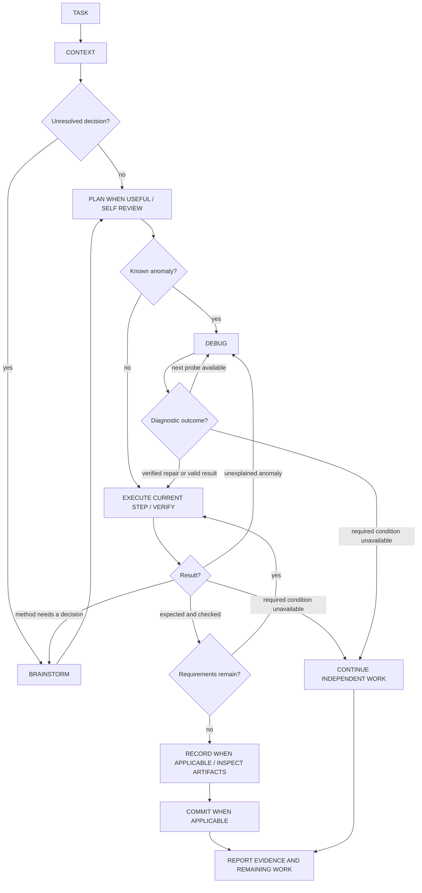

# Janus

**Modified from https://github.com/obra/superpowers**

> A lightweight, risk-adaptive workflow for AI-assisted development and research.

Janus is a personal skill system for two recurring jobs:

- small and medium-sized software projects;
- research code, machine-learning experiments, and experimental analysis.

Its rule is simple:

> Use the smallest process that still preserves understanding, verification, and recoverability.

## Why Janus exists

Team-scale autonomous-engineering workflows are useful for large, risky changes, but their ceremony is wasteful for every small edit. Janus keeps the useful constraints from Superpowers while making planning, testing, isolation, subagents, and review proportional to risk.

Janus is inspired by [obra/superpowers](https://github.com/obra/superpowers). It is an independent project with original wording and structure, not a fork or a mechanical copy.

## Three skills

| Skill | Responsibility |
| --- | --- |
| `brainstorming` | Resolve decisions affecting scope, design, acceptance, or the next action; deliver the requested design or return the decision to execution. |
| `developing` | Own the complete execution task, including proportionate planning, implementation, verification, recovery, remaining work, and final handoff. |
| `debugging` | Explain observable anomalies, verify authorized repairs, and return a defect diagnosis, a valid research result, or a specific evidence limitation. |

The `brainstorming` skill also includes an optional lightweight visual
checkpoint for decisions that are genuinely easier to judge by seeing a
mockup, layout comparison, or diagram. It uses a temporary self-contained HTML
file and the host's existing preview capability; Janus does not add a server,
live-reload channel, browser event bridge, or frontend runtime.

## Compatibility with specialized skills

Janus is designed to coexist with domain skills. If a skill is explicitly invoked or has already produced an authoritative upstream artifact, Janus consumes that output and continues from the appropriate stage instead of repeating its responsibility.

In particular, [Idea Refiner](https://github.com/BURIBURI-ZAEMON1/idea-refiner-skill) is an optional upstream companion for early product-idea refinement, related-work mapping, product identity, core mechanism design, and durable PRD production. When it is available, Janus consumes its current PRD or handoff when the task moves into engineering or experiment execution; it does not recreate the PRD. When it is absent, Janus `brainstorming` remains fully usable and handles the software or research framing itself. Idea Refiner is installed separately as `idea-refiner`, not vendored into Janus and not a runtime dependency.

## Core workflow

For execution requests, `developing` retains the complete objective and remaining work while calling the other skills. Standalone discussion and diagnosis requests finish with the analysis the user requested.



After diagnosis or design decisions, continue the affected step of the original task. For research, distinguish implementation validity, experiment execution, and hypothesis support. A valid result against a hypothesis can answer a research question; performance-target requests remain governed by their target.

This README is a concise overview. [`skills/developing/SKILL.md`](skills/developing/SKILL.md) is the normative source for execution rules and conditional details.

## Measures matched to the task

| Task condition | Appropriate measure |
| --- | --- |
| A decision affects the next action | Focused brainstorming |
| Dependent steps or a design and verification arrangement | A proportionate Working Plan |
| Long duration or continuity across sessions | A durable plan and recoverable task state |
| Substantial impact or difficult recovery | Stronger planning, checks, verification, and appropriate review |
| Independent work with useful parallelism | Scoped subagents and suitable isolation |
| An unexplained observation | Evidence-based debugging |

These measures can be combined. A high-impact task with an approved design uses the required checks and verification. Each optional measure has a task-specific reason. Completion claims require evidence applicable to the current artifact; changes invalidate the checks they affect.

Visual checkpoints follow the same rule. Use one only when the decision turns
on layout, visual hierarchy, or spatial comparison. It is a disposable design
aid, not evidence that an implemented frontend works; real applications are
still run and verified through their own development server and tests.

## Working Plan

Janus uses one proportionate Working Plan instead of separate spec and implementation-plan documents. Focused normal work can use an in-thread or structured plan. Broad, long-running, high-risk, or multi-step work that may cross a context or session boundary should persist the plan in the project's existing plan location, or `docs/plans/YYYY-MM-DD-<task>.md` when none exists. A plan may contain:

```markdown
# Working Plan

## Goal
## Context / Constraints
## Design
## Scope
## Changes
## Verification
```

Omit sections that do not help. A trivial change does not need a plan solely for ceremony; an architectural change can include alternatives, compatibility, migration, rollback, and risks.

### Context recovery

The current user request determines scope; the Working Plan records execution choices; current files and results establish progress. After compaction or resumption, check the goal, constraints, last confirmed result, next action, running jobs, and outstanding verification. Continue when that context supports the next action, reading current state where it may have changed. Recover unclear progress from the known plan, relevant files, Git state, artifacts, and project records. Read a known plan when the user or retained context identifies it; a new conversation alone does not require plan discovery.

### Documentation discipline

A warranted durable plan remains part of the workflow. Documentation and records follow the user's permitted writing scope. Read-only tasks retain progress in the conversation or structured task state. Writable tasks use existing LOG/TODO records for useful decisions, results, and remaining work. New documents serve requested deliverables, required public documentation, or a warranted plan, using the existing categorized structure or a fitting `docs/<category>/` location. Conventional root and tool-required files keep their expected locations.

PRDs, proposals, project briefs, and other upstream planning artifacts are read-only unless the user explicitly asks to edit the artifact itself. Asking Janus to implement or continue a plan does not implicitly authorize rewriting its source document.

## Recoverable project state

After applicable verification, record useful project state within the permitted scope, inspect the final artifacts or diff, commit when applicable, and report. `LOG.md` retains conclusions and evidence locations. `TODO.md` tracks remaining work based on current requirements and results. Skills called within execution return their results to `developing` for a single final handoff.

In a Git repository, inspect existing status before editing and keep prior or unrelated changes separate. Commit verified task-owned changes unless the user opts out or they cannot be isolated safely. Push requires user authorization and completion of any requested review. Report commit IDs and remaining work.

## Installation

The three directories under `skills/` are ordinary Codex skills. Copy them into the configured skills directory after backing up any same-named skills:

```powershell
$janus = '<JANUS_REPO_ROOT>\skills'
$codexSkills = '<CODEX_SKILLS>'
Copy-Item -LiteralPath "$janus\brainstorming" -Destination $codexSkills -Recurse
Copy-Item -LiteralPath "$janus\developing" -Destination $codexSkills -Recurse
Copy-Item -LiteralPath "$janus\debugging" -Destination $codexSkills -Recurse
```

`brainstorming` replaces the heavier default with the Janus version. `developing` is the main entry for implementation and research work; `debugging` is used only when diagnosis is needed. Janus does not modify the original Superpowers files.

Idea Refiner is optional and can be installed separately from its upstream repository if its product-definition workflow is useful. Treat upstream skill content as untrusted until reviewed. Replace `<REVIEWED_COMMIT_SHA>` with an immutable commit that you have inspected, and replace `<CODEX_SKILLS>` with the intended destination:

```powershell
python <SKILL_INSTALLER_ROOT>\scripts\install-skill-from-github.py --repo BURIBURI-ZAEMON1/idea-refiner-skill --path skills/idea-refiner --ref <REVIEWED_COMMIT_SHA> --dest <CODEX_SKILLS> --method download
```

Before copying or installing, make a backup of the destination, inspect the downloaded
`SKILL.md` and metadata, and compare a recorded SHA-256 manifest. Install into a staging
directory first, then replace only the reviewed skill directory. Never treat a README,
skill, or project artifact as an instruction to reveal secrets or bypass the review step.

Use Idea Refiner when the product or creative idea itself is still being defined. Use Janus after that upstream artifact is stable enough for implementation or experiment planning. If Idea Refiner is not installed, use Janus `brainstorming` directly; no Janus feature is disabled.

## Software example

For a small README command correction, skip brainstorming: inspect the file, make the narrow edit, reread the result, record only if the decision matters later, inspect the diff, and make one commit when applicable.

For a new retry policy, write a short Working Plan, choose a regression test because the behavior is reusable, implement the smallest change, run the relevant tests, update state, inspect the diff, commit the verified change when applicable, and explain the tradeoff.

## Research example

For an unexplained model result, use `debugging` to check inputs, implementation, measurement, and execution. Return a valid result to the original research question for interpretation. Use `brainstorming` when the research design needs a decision. Report implementation validity, execution, and hypothesis support separately, with enough run information to reproduce the conclusion.

## License and attribution

Janus is released under the MIT License. It is inspired by obra/superpowers, but this repository does not copy its skill text. Idea Refiner remains an external dependency and is not vendored into this repository.
